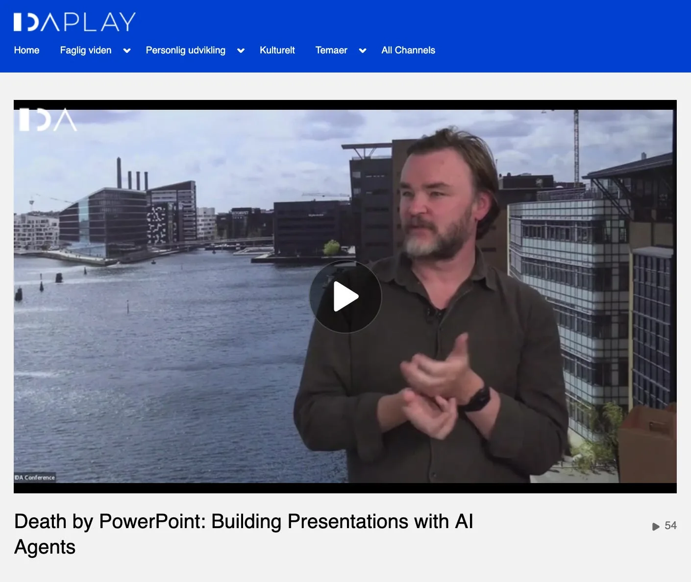

A couple of weeks ago I did a webinar with IDA on “Death by PowerPoint: Building Presentations with AI Agents” - and the [video is now out here](https://videos.ida.dk/media/Death%20by%20PowerPoint%3A%20Building%20Presentations%20with%20AI%20Agents/1_qhtz2g38). Check it out…

<!-- truncate -->

When I turned up at [IDA](https://ida.dk/) after an invitation from [Mikkel Hansen](https://www.linkedin.com/in/mikkelgedehansen/) I didn’t know what to expect, but I assumed it would be my voice-over on a presentation like other webinars I have done in the past - but no! The professionalism of IDA surprised me with a green room with coffee and snacks, two video engineers and a studio akin to a TV News Room where Mikkel and I could chat over what I had brought to talk about.

I only wish I had worn my fancy shirt.

I did however really like the format and would encourage it elsewhere - having a conversation and chat about the subject is way better than just one person droning on, with Mikkel being an effective voice of the audience, bringing me back from jargon and techy speak on occasion.

As such I’m really happy with what the webinar tried to communicate, which was, **we can spend more time on the ideas** and less time wrestling with a notorious format, PowerPoint.

And the quicker we can get our ideas out there, the more we can iterate and hone and apply taste to them - not just produce lots of low quality slides, but use it to make fewer but higher quality communication media.

## Powerful points?

As I mused a few weeks ago, we are perhaps moving to a world where we don’t have to worry about technical details like files anymore:

*[Maybe we don't need file formats anymore, post AI](/blog/maybe-we-dont-need-file-formats)*

As a result of the questions from the talk I thought more about what it means to be “technical” vs not in this age where AI can help us through the messy bits - that boundary is hazy and shady to me now.

I think there are still some barriers getting to grips with concepts like version control and code updates, but as I mention in the post above a lot of the iPad generation also don’t know much about folders and files anyway, if they haven’t had to use a traditional computer.

I think a lot of the job for AI platforms now are working on that **USER EXPERIENCE** of their harness or app: really see how the users can be free to create and use the AI but in a way its not too complex.

A real danger making AI applications is that because you can make a lot of features quickly, so that you overwhealm your users as you build faster than they can process the change management needed to use them.

So the best feedback I had from the webinar was that some live listeners were able to take the templates and make their own presentations as a result of the talk. To help that along I also packaged it up a bit and published online: [https://www.sunholo.com/presentations/starter/](https://www.sunholo.com/presentations/starter/)

But even without that template, I hope others were inspired just by unlocking the idea: you can now just ask AI (as I did) what would be the best way to present your ideas. I didn’t explicitly avoid PowerPoint, it just never came up.

And it applies wider than that: we only lack ambition with these new tools. That’s why I’m building a new programming language, operating system, space simulator, universal document parser, education platform, contract logic etc etc - because the barriers that stopped me before are melting away.
