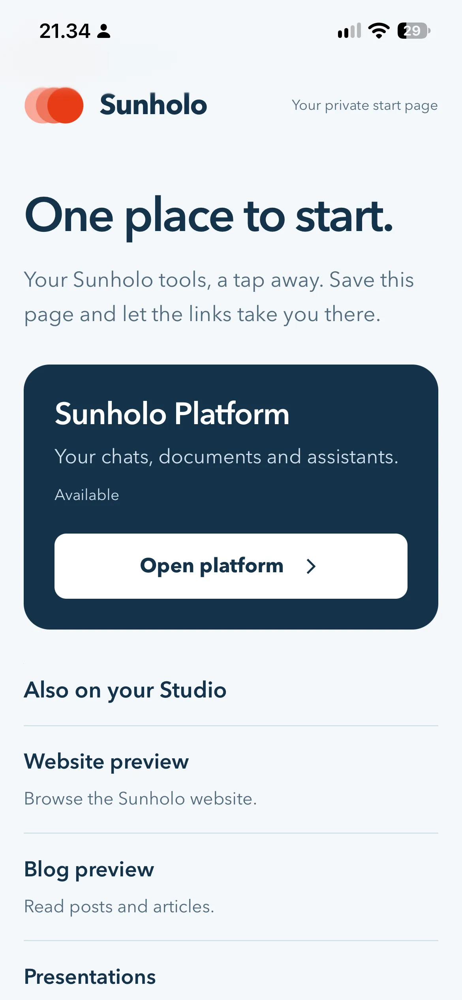
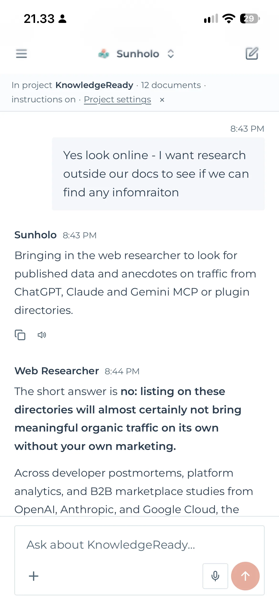
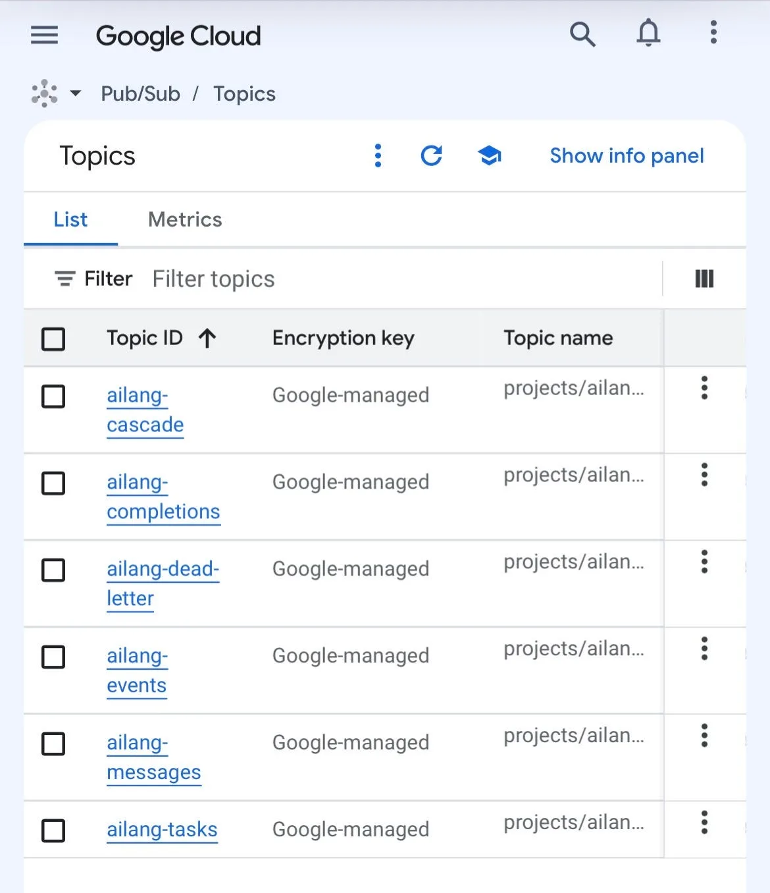

I get a few questions about my working environment as a day to day AI Platform Engineer, which can be difficult to answer definitively since it changes rapidly, but I figure if I give a snapshot now it will be of interest in say 12 months time to see what changes.

<!-- truncate -->

## Subscriptions and APIs

I run a $200 per month Claude Code Ultra that is my main driver; a $100 OpenAI Codex that seems to drive a lot of value; a $20 Ollama Cloud for mostly running GLM Flash 5.3; a $25 Gemini Enterprise seat; an OpenRouter API project with $100 monthly budget set.

I feel it’s important to have broad access to not get too locked in to one provider, but certainly Anthropic would be my choice if I was forced to choose only one. I typically use all my quotas each week via the mission loop quota system I detail below.

## IDEs, chat and UIs

I mainly interact with the above subscriptions via my MacBook Air laptop on a terminal using iTerm running [herdr.](https://herdr.dev/)

At the start of the year I used Visual Studio and the Claude plugin more, but find herdr better to deal with lots of running AI threads, and good remote server support.

I run 90% of my sessions logged in remotely to a Mac Studio Pro 128GB machine that is always on (dubbed “the rig”), so can kick off long running tasks and detach/reattach easily - I have a CLI shortcut “hr” that takes care of connection through Tailscale. [Tailscale](https://tailscale.com/) runs on my phone, laptop and the rig.

I run private tasks on the laptop with a local herdr server. These include interacting with my email and some client work. I use [AILANG Parse](https://www.sunholo.com/ailang-parse/) and an unreleased internal tool called AILANG EParse to classify and semantic search local email threads, documents and attachments using local small models and embedding, run via [Ollama](https://ollama.com/). It’s way more useful than other native email AI tools I’ve tried.

I have many Skills and hooks for Claude including an audio text to speech synopsis of completed agent threads (useful when running many in background) and sending local tasks to the rig. I keep this synced via a GitHub repository synced between rig and laptop.

Ollama is also running on the rig, running currently [Qwen3.8 27B](https://ollama.com/library/qwen3.8:27b) for local AI tasks and Gemma4 12B for fine tuning. We have a proxy to the Ollama endpoint to help queue and run scheduled jobs that keep the GPU humming 24/7 on AILANG evals, fine tuning and recently some local game assets, audio and image generation.

Having the rig on all the time is a real boon - it doesn’t have to be as big GPU wise but that is useful for research and private AI workloads. Local AI is not very fast token wise compared to cloud models and makes no sense from an economic perspective.

## Internal AI chat applications

With the rig running 24/7 I can run web applications via a [localhost](http://localhost) HTTP server that serves through a private VPN network using Tailscale, with access to rig resources.

One HTTP service is a localhost version of the [AI Protocol Template, a Google ADK Python backend running React frontend](https://github.com/sunholo-data/ai-protocol-platform) that is the source template for several downstream client projects.

It takes a protocol first approach, with Skill support. It runs A2A, MCP client and server of skills, AGUI and A2UI for interactive dynamic UI. This AI protocol application handles my day to day chats with AI for non-coding tasks, like web research, querying my local GCP billing, AILANG message queues and approvals, Daneel channels etc. The template uses AILANG parse to provide world class document analysis developed for clients, and supports projects for specific tasks such as client work. Each project holds an [Open Knowledge Format](https://cloud.google.com/blog/u/2/products/data-analytics/how-the-open-knowledge-format-can-improve-data-sharing) wiki backed up by GitHub.

This replaces day to day chats with say OpenAI ChatGPT or Anthropic Claude, but I may occasionally use them for general queries outside of company work, and for testing MCP or A2A integrations. I also have Gemini Enterprise that I sometimes flip to but it’s mainly just to keep up with how it’s developing.

## Coding harnesses - Cloud executions, Mission Loops

I use Claude Code with Anthropic models, Codex with OpenAI. When working with AILANG I’m currently A/B testing with Pi vs Motoko, and for other work I use Pi with a few extensions. These preferences are after many on-device evals showing OpenCode as the worst in performance vs Pi and Motoko, with Pi being a good default whilst Motoko is being developed.

The coding harnesses all have a Docker implementations that are deployed to Cloud Run jobs. These allow agent tasks to be thrown up to run on GCP, where they sync with configuration shared via a Cloud Storage bucket. These run the long running tasks that are created from the AILANG message system, that is an AILANG coordination system built into its binary.

## AILANG message system

This is a platform agnostic system for coordination between agents. It uses SQLite locally and Firestore / PubSub on the cloud.

It’s used to take care of all inter-agent and agent-me inboxes. It’s mainly used to handoff between my typical workflow of design doc, sprint plan, sprint execute and sprint evaluation. They run when a GitHub issue is raised on monitored projects, and handle the AILANG package ecosystem bumps. Each inbox is monitored by an AI agent coordinator and kicks up approvals to me if needed. I typically start my day by going through these approvals that have gathered overnight.

I then usually check in on the long running bigger projects that I dub [Mission Loops](/blog/ai-loop-engineering-dark-software-factory). These are multi-week running tasks that have a roadmap I update and triage, to be later picked up by the AI agents running in the loops. Examples include creating AILANG World, an operating system for AI; Stapledons Voyage, a space simulation and v1.0.0 of AILANG getting ready for release.

The mission loops have quotas to use up roughly 20% of all my provider AI subscriptions per day. They have auto-fallback if one quota is spent eg if Claude is running too hot then switch to Codex, if that’s spent switch to OpenRouter models like Deepseek, etc. This means I usually run dry my quotas by the weekend which is good from a work/life balance perspective.

Most AI agents work is run via the Voight-Kampff GitHub account to keep permissions easy and separated from my own personal accounts on the laptop. I have now also introduced a new Daneel account to help coordinate all the above, which I’m experimenting with to help create a virtual employee with its own access, budget and computer accounts. I interact with Daneel mostly through emailing them, via a Skill that calls Daneels AILANG message inbox or on Discord.

## Daneel

[Daneel is an assistant](/blog/introducing-daneel) that has a 5 minute scheduler that checks for tasks to do.

They have a list of growing capabilities such as message triage, LinkedIn content creation, Substack subscription reading, website updates and GitHub issue triage. They write to me on email with a morning and evening report, and during the day as and when alerts or tasks come up. It’s an exercise in running AI I can trust by not just letting an unrestricted agent work on my behalf, but to have good solid boundaries - to work up rungs of shadowing, approvals and automation.

## What it gives me

The above has from a production point of view probably made me x10 more productive at least vs say 3 years ago. The biggest unlocks were having the rig on 24/7 and having the mission loops constantly grinding.

Here is an AI visual representation of the post above. Any questions let me know.

