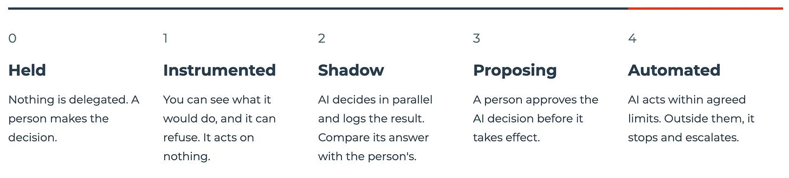
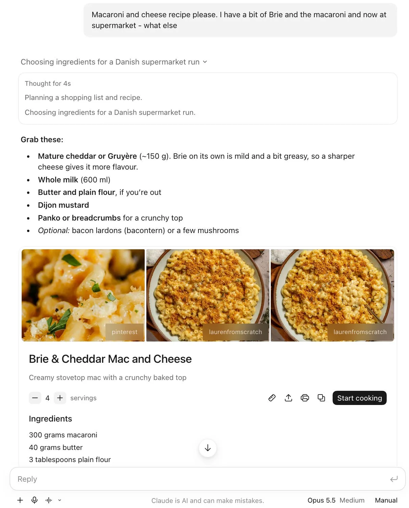
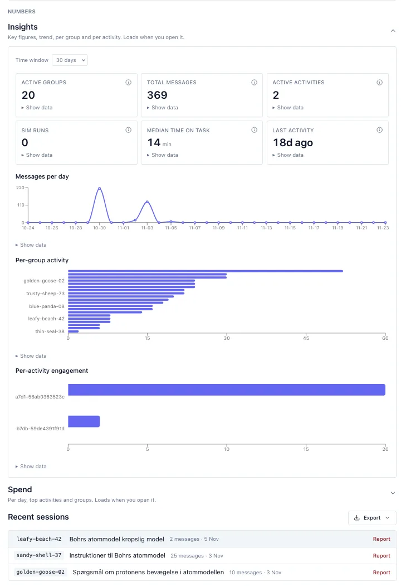
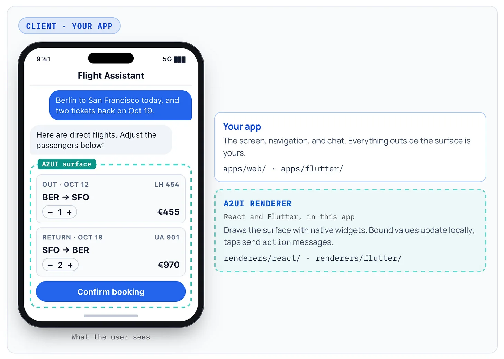
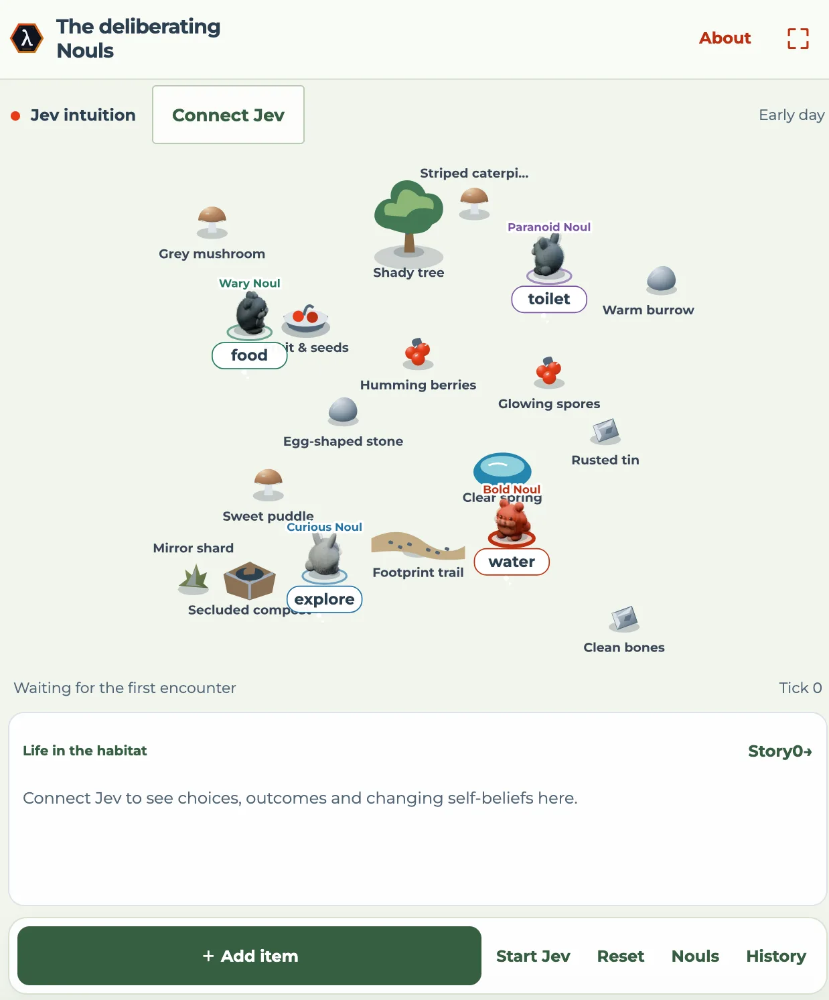

I think its safe to say, the week after Anthropic’s $1.5T IPO, that AI will change the world. Positively or negatively is the question, but my opinion is it will be a net benefit for humanity.

<!-- truncate -->

But it is still very early days - as the [Anthropic IPO SEC filing](https://www.sunholo.com/ailang-parse/sec-filings.html) mentioned, most companies in the Fortune 500 are only spending 0.1% of their total operating expenses on AI: the implication being that there is a lot more spend to come and Anthropic’s share price will benefit as a result.

I think its safe to say that AI adoption will continue to increase. Whether Anthropic capitalizes on that before spending commitments catch up to them is an open question. Looking at the AI industry overall though, my bet is on AI becoming the primary way we will work in the future.

But for AI benefits to filter through to the real economy, most AI practitioners agree its likely not via today’s standard chat-to-AI user interfaces.

How then, will we be interacting with AI in the future?

## Which AI User Interface (UI) for you?

The AI gains we see today for software engineering are a result of coding harnesses such as Claude Code and Codex hitting a product market fit with agent based coding, all sitting within traditional coding UIs: the command line and IDEs. Model quality also played a part - around December 2025 is when Opus 4.5 was released and identified as the tipping point.

For the same revolution to appear in other industries, it won’t use the same UIs built for software engineering. It will be via industry specific UIs suited to their own working day to day. The “killer app” for other sectors such as legal, marketing or education won’t be the same as the one found for software engineering.

The Chat-to-AI interface introduced by ChatGPT got us to where we are today: its generic enough that people have thought up many ways to use it to access productivity unlocks.

Coders used chat-to-ai **until tools such as Cursor and Claude Code moved the AI interface to a better setting**. A UI switch will also be needed for other sectors to see similar AI take-overs like what has occurred in software engineering.

But what are the issues around the current chat-to-AI UIs? Won’t they be sufficient?

## Problems with the Chat-to-AI UI

Below we list a few reasons why a chat-to-AI UI is not suitable for advanced AI automation:

### We are not meat proxies

One problem with AI chat, is the “meat proxy” situation.

This is when the human is reduced to being part of an AI loop, hitting enter continuously to agree, or copy-pasting from one system to AI and back again. This is identified in the [Decision Budget](https://www.sunholo.com/decision-budget.html) process as when an AI integration is stuck at rung 3: Proposing.

*Decision Budget Rungs for AI*

For some processes, having the AI permanently at rung 3: Proposing is a good thing - the AI isn’t acting autonomously or having access to external tools the human instead governs, which suits sensitive or influential actions. The human has to always do the final check or action.

However, if the process is more routine, and the AI has proven it is competent enough, being stuck at rung 3: Proposing is a productivity blocker for the human.

The human becomes a servant of the AI: a cog in its machine where the role of AI is to instruct them rather than the other way around - this is demoralizing for humans!

There are many examples online where people report they do nothing more but be an enabler of AI output. To break free of this, the next rung is needed - but that is only granted once [enough trust has been earned to move human oversight to another abstraction layer.](/blog/verification-trust-abstraction)

Outside a chat environment, AI can move more easily to rung 4: Autonomous - the Agent.

Background and long running tasks are where the AI is more self sufficient, the human bottleneck is removed and faster iteration can occur to improve quality and quantity.

## Chat-to-AI’s Context Management problem

Another problem with chat is context management - what text, files, images etc. are sent to the model to recognize and generate answers for.

In chat-to-AI UIs, this is primarily the chat history and what you as the user prompt the AI to do. Innovations over the last few years have included enriching that context with more sources such as including tool calling (e.g. web search), MCPs, and Skills.

But in a chat-to-AI UI, that can only go so far. Chat history is append-only, hard to keep track of and linear. Tool calls, MCPs and Skills make the context richer, but they don't help to make it *controllable*: you can't easily see it, prune it, pin what matters, or reuse it.

In the screenshot below we have a good solid answer on how to make macaroni and cheese, but its difficult to examine the sources, verify or observe how the answer was generated. For my evening meal this doesn’t matter so much, but for more critical workflows it does.

*Example of a chat-to-AI session. Good answer, but if you want to examine sources, edit, attribute or alter them how do you even get started?*

Coding agents work around this by going beyond the chat and working more dynamically with the entire file system: they move the context management into the environment around the code, as well as getting more freedom to write and discover their own context. Chat-to-AI UIs struggle to work in the same way.

### What is Chat-to-AI doing on our behalf?

Another issue with the Chat UI is observability and trust. In some cases too much observability, in others too little: both of which impact how much trust we assign to the AI.

### Too much information (TMI)

Too much information is a problem of prioritization. Yes, the AI may succeed and achieve great things such as a proof of a [150 year old Riemann Hypothesis](https://alpo.ge/remark.pdf) - but to audit that proof involves reading 250k pages of proof!

For day to day uses of AI, trust is lost if it outputs too much information to be auditable, even if correct. Long threads of chat history make human eyes glaze over - moving more into visual, audio or video mediums may help and will likely become more prevalent over the next few years as more efficient ways to communicate lots of information.

### ..and too little information (TLI)

And here is an example of too little information, observed in one of my projects: education for a group of students.

The AIPLA project works with teachers to help use AI in physics education. Some have tried to use vanilla Chat-to-AI UIs within the student group, but that meant a teacher lost observability on what the students were asking or doing. This was a major barrier to adopting AI in the classroom, and was one of the first features we added to AIPLA to give teachers.

Having a classroom overview on what the students were using the AI for, with the ability to get live updates, calls for help and after activity synopsis gave the observability and trust needed to progress to configuring the actual activity.

The screenshot above shows a teacher view for the groups learning about Bohr’s model for the atom. Student’s interactions with the AI can be used to support the teacher in their lesson plan.

## What Human-AI UIs will we see?

All this means I am most curious about the new modes of interaction we see with AI-Humans, since this is a new field that no-one really knows the answers to yet - even Claude Code was an unexpected hit both within Anthropic and at its competitors.

We have seen some steps towards what UIs will look like beyond Chat-to-AI in the AI industry, and I’ve tried a few directions myself. I list a few below:

### Vocal inputs and outputs

A few practitioners swear by voice input as a productivity unlock, and although I can see it helping for those without a high typing speed I feel like a right berk trying it in a day to day session.

We see some startups looking to solve this with close-up whisper microphones and even sub-vocalization lip reading/throat palpitation interpretation to solve the busy office scenario - this may work for some but its not something I think I would use.

Where I do see voice AI making good sense is when you have a group scenario - for instance the meeting voice recording applications that are proliferating.

We also use it in AIPLA (as an opt-in) for when **student groups** are discussing the relevant exercise - the conversation can then be parsed post-meeting and used to make sure nothing is forgotten or missed. This makes sense to me and I can see this quickly becoming an AI norm.

Another use for voice UI I have not yet tried yet is the more rambling chain of thought brainstorming that you could do on a walk or during exercise, where the AI can parse out all the talking and write it up into a coherent document. I may give this a go if I find where it can fit in my daily routine - perhaps for blog posts like these?

We also now have AI’s talking on the phone. The results of these vary widely, and I’m not sure we are ready for it to hit mainstream yet.

I have cloned my voice and its convincing so will use it for promotional voice-overs, but have on the other side of the coin warned my family to not send me money if I ring up and ask for it - since it may not actually be me asking, rather a scammer with my voice-print.

A trust mechanism is needed for this. I know customer support is pretty far advanced with this and its likely you have already spoken with an AI on the phone - I guess if we see improved service then we will be convinced its better than a human.

## Non-Textual HTML UIs

Another route for AI-UI is when the AIs return not text replies, but structured data that is used to display rich interactive UIs on webpage HTML.

This is what I’ve been working with most via the MCP Apps and [A2UI protocols](https://a2ui.org/quickstart/), both of which are embedded within my open-source [AI Protocol Platform](https://github.com/sunholo-data/ai-protocol-platform) I use for a lot of client work.

*From https://a2ui.org/quickstart/*

This I think has a lot of potential and will catch on - we are already seeing the protocols being integrated within the Chat-to-AI UIs who increasingly reply with much richer outputs.

But A2-UI can also be used outside of a chat environment - the promise of A2UI is it can interact with any part of a webpage - the navigation, footer, header, content etc. could potentially all be controlled via AI outputs.

I have not yet seen this really taken to an extreme, and look forward to: could a website potentially be dynamically created as a user browses through it?

## Speedy AI for Speedy UI

For a full AI controlled output to work we need speedy responses, quicker than normal chat AIs.

No UI is going to be used if we are sitting around waiting for a chat turn to finish all the time, so speed seems to be of the essence in the future AI-UIs.

This is now closer to being available with the recent releases of a new class of AI models such as [Jev](https://typesafe.ai/blog/introducing-system-one-models-and-jev). These “decision models” (or System 1 models) don’t output text but rather very quickly return structured data e.g. send in a user’s history, it responds within a few microseconds.

I played around with this a little with [The Deliberating Nouls](https://www.sunholo.com/ailang-demos/decisions/) - a virtual life decision simulator built in AILANG web assembly. A player alters the environment of the Nouls by describing items and the AI creates them, then Jev controls the decision making in real-time on whether the Noul investigates, runs away or eats the new item.

The Nouls walk around and the user (if they hook up their OpenRouter API key) can create items and place them within the environment to see how the different personalities react. Its an experiment to see if we can do co-creation with AI, and how it may extend to real-life website applications.

## Humans will stop caring about files or coding languages?

As a final thought around AI-UI to leave you with, I want to follow up from a previous post I made that perhaps when we truly embrace AI abstraction, file formats will melt away:

*[Maybe we don’t need file formats anymore, post AI](/blog/maybe-we-dont-need-file-formats)*

This follows along from my thesis on AILANG: if AI is doing all our coding, why would we dictate what programming language it uses?

Likewise, if AI is dealing with all our files, why would we dictate what file format they use?

If AI is taking care of details such as file format and programming language, what then should be the interface that the human will deal in? What atom of interaction do we use, if the old mediums of file or programming language melt away?

This post is long enough now that I’ll split that up into a post for next week - where I will explore more on what those atom’s of interaction between AI and humans may be, and how its impacting my work on a new AI Operating System, [AILANG World](https://www.sunholo.com/ailang-world/).

AILANG World’s tag line is “Unix made everything a file. World makes everything a **typed state transition**.” - perhaps it is that typed state transition that will be a new atom of work.
